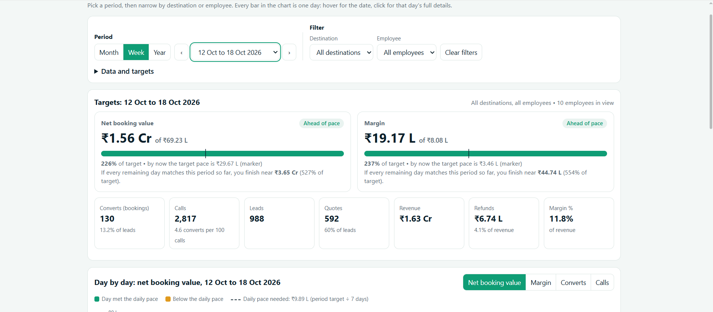
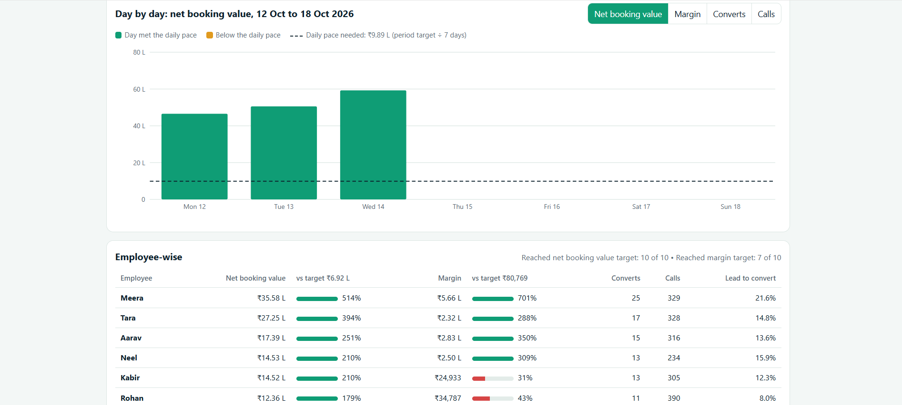
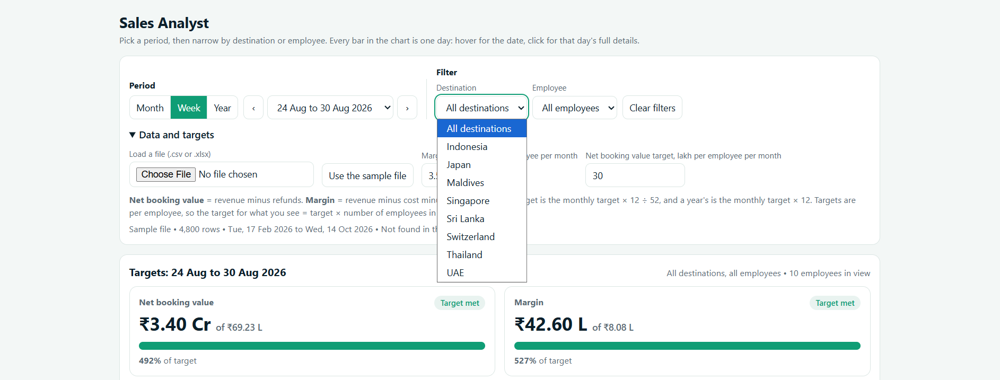

# Sales Analyst Dashboard

An interactive, offline sales-performance dashboard for a travel-sales team. It is a single HTML file: no server, no install, no internet connection needed.

**Live demo:** https://deshhhhhhh.github.io/sales-dashboard/
**Author:** [Deshhhhhhh](https://github.com/Deshhhhhhh)

## Screenshots

### Targets overview
Net booking value and margin against the monthly per-employee targets, with a pace marker, projection and summary tiles (converts, calls, leads, quotes, revenue, refunds, margin %).

### Daily chart and employee-wise table
One bar per day. Bars above the dashed daily-pace line are green, bars below it are amber. The employee-wise table ranks everyone against their target.

### Period selector, filters and data settings
Switch between Month, Week and Year, step through periods, and filter by destination and employee. "Data and targets" holds the file loader and the editable targets.

## Features
- **Targets per employee per month:** margin ₹3.5 L and net booking value ₹30 L (both editable in the app).
- **Pace tracking:** shows whether the current period is ahead of or behind target, where you should be by today, and a projected finish at the current run-rate.
- **One bar per day:** hover to see the date and key numbers; click to open that day's full details.
- **Day details panel:** converts with lead-to-convert and quote-to-convert rates, calls, leads, quotes, average booking value, revenue, refunds, cost, margin, a calls → leads → quotes → converts funnel, and every employee/destination entry for the day. Previous/next day buttons move through the period.
- **Chart metrics:** switch the bars between Net booking value, Margin, Converts and Calls (plus Calling minutes when the data has it).
- **Period views:** Month, Week or Year, with previous/next navigation.
- **Independent filters:** Destination and Employee, used together or separately. Clicking a row in either table applies that filter.
- **Employee-wise table:** net booking value and margin against target, converts, calls and lead-to-convert rate, with a count of how many employees reached each target.
- **Destination-wise table:** net booking value, share of total, margin, margin %, converts, calls and lead-to-convert rate.
- **Load your own data:** CSV or Excel (.xlsx/.xls) with automatic column detection.
- **Light and dark mode:** follows the system setting.

## How the numbers are calculated
| Measure | Formula |
|---|---|
| Net booking value | Revenue − Refunds |
| Margin | Revenue − Cost − Refunds |
| Margin % | Margin ÷ Revenue |
| Lead to convert | Bookings ÷ Leads |
| Quote to convert | Bookings ÷ Quotes |
| Monthly target | Per-employee target |
| Weekly target | Monthly × 12 ÷ 52 |
| Yearly target | Monthly × 12 |
| Target in view | Per-employee target × number of employees in view |
| Daily pace | Period target ÷ days in the period |
| Pace marker | Target × (days elapsed ÷ days in the period) |
| Projection | Actual so far ÷ share of the period elapsed |

If a destination is selected, the figures show that destination's contribution towards the employees' full targets.

## Data format
Columns (names are detected automatically):

`Date, Destination, Employee, Calls, Leads, Quotes, Bookings, Revenue, Cost, Refunds`

An optional call-minutes column (for example `Call Minutes` or `Talk Time`) adds calling time to the KPI tiles, the chart and the day details. Without it, those places show "Not in file".

## Sample data
The included dataset is **synthetic sample data** (4,800 rows, 10 employees, 8 destinations, 17 Feb 2026 to 14 Oct 2026) for demonstration only. It does not represent any real company's results. Because the sample figures are well above the targets, most employees show 2 to 6 times target; change the targets in "Data and targets" to match your own data.

## Run it
Open `index.html` in any modern browser, or use the live demo link above.

## Built with
- HTML, CSS, vanilla JavaScript and inline SVG charts
- [SheetJS](https://sheetjs.com) (Apache-2.0) for Excel import
- Built with AI assistance (Claude by Anthropic), from requirements and testing I provided

## Known limitations
- Targets are per employee, so they are not set per destination.
- Targets are saved in your browser only, not shared between devices.
- The week-to-month and year targets are simple scalings of the monthly target.

## Ideas for next steps
- Export a day or period to PDF or CSV
- Per-destination targets
- Compare two periods side by side
